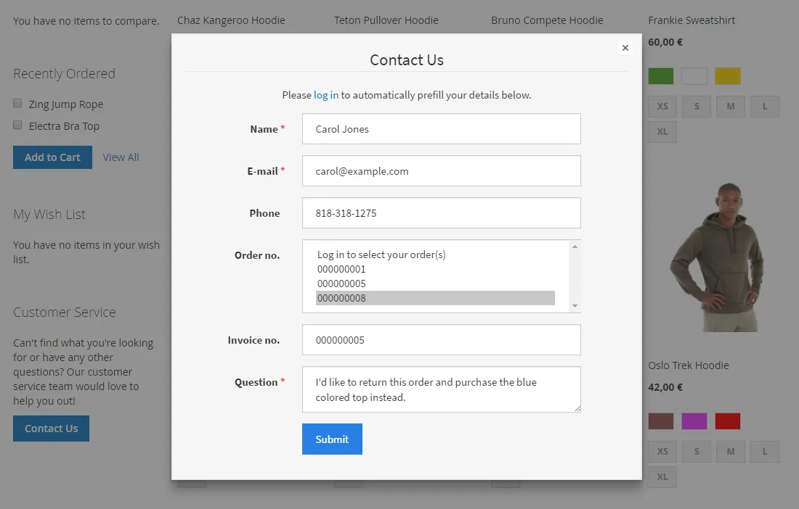
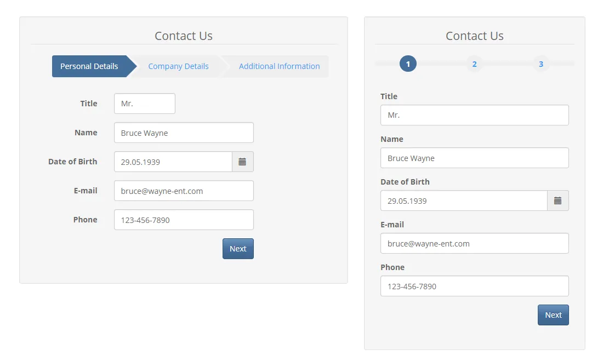
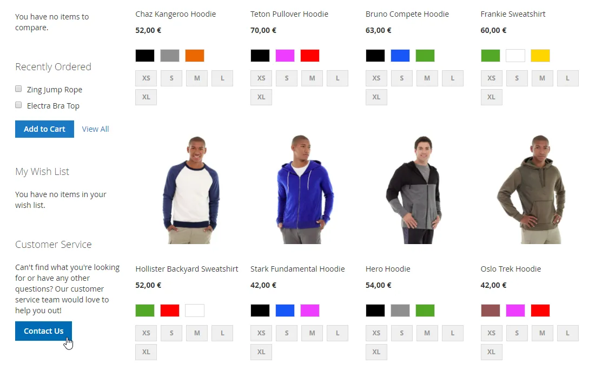
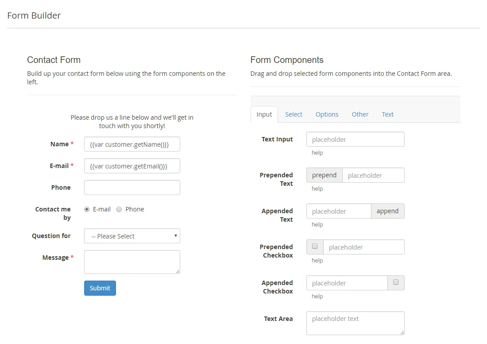
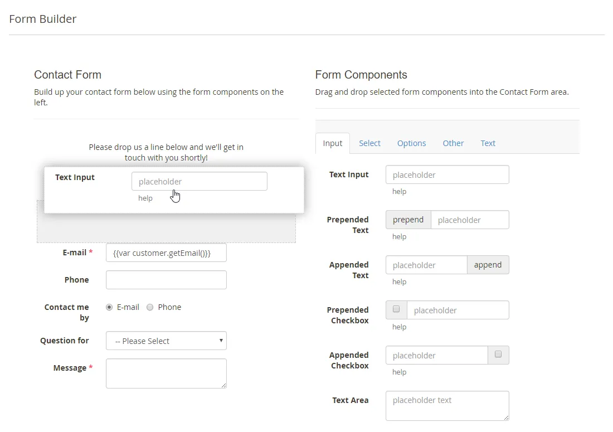
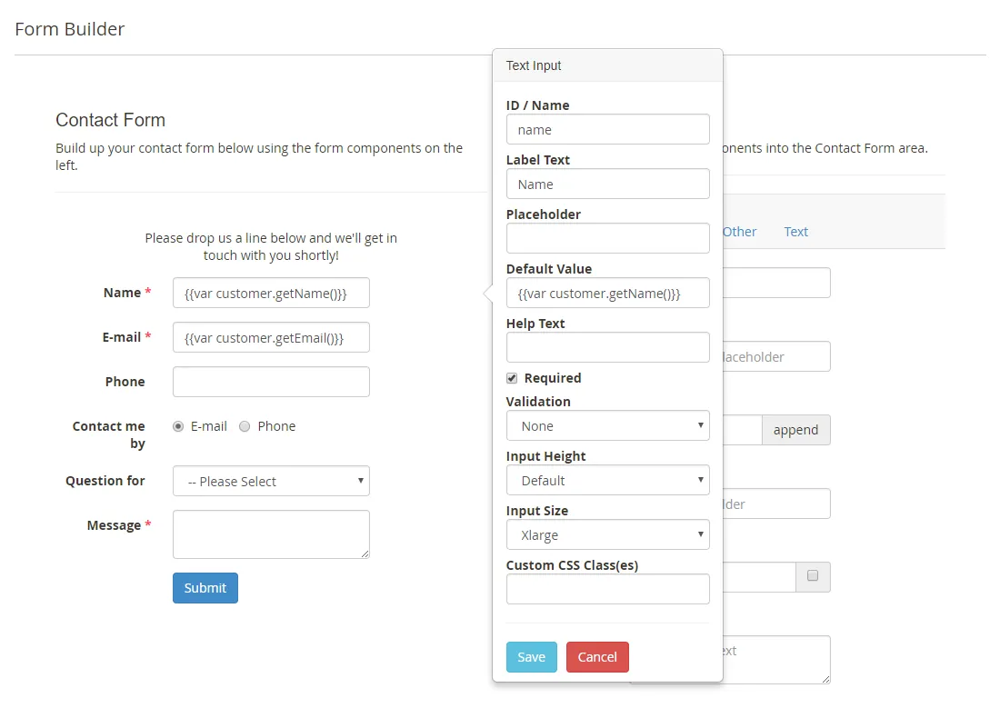

# Custom Contact Forms for Magento 2

**Drag-and-drop contact form builder for Magento 2.**



Build contact forms in the Magento 2 admin with a drag-and-drop form builder, a wide range of form fields, 18 front-end themes and many display options.

Includes customizable e-mail notifications, widgets to embed forms anywhere and management of form submissions in the admin.

> [!NOTE]
> Custom Contact Forms is free and open source under the MIT License (since 2026). Plugin Company no longer actively develops this extension, but issues and pull requests are welcome.

## Features

### Front-end features

- 18 Bootstrap themes and many design options
- Responsive, AJAX-based front-end forms
- Form validation with Google reCAPTCHA or visual captcha
- Pop-up and slide-out forms via widgets
- Multi-page and multi-column forms
- Conditional form fields for dynamic forms
- Pre-fill fields with customer, product and store data
- Multilingual: labels and options per store view

### Admin features

- Drag-and-drop form builder
- Wide choice of form fields, including file upload
- Optional front-end page (URL) per form
- Embed forms in CMS pages, blocks and layouts with widgets
- Customizable customer and admin e-mail notifications
- Conditional admin notification recipients
- Save and manage form submissions in the admin
- Translate form fields and notifications per store view

## Screenshots

<table>
  <tr>
    <td width="50%" valign="top"><br><sub>Slide-out contact form</sub></td>
    <td width="50%" valign="top"><br><sub>Multi-page contact form</sub></td>
  </tr>
  <tr>
    <td width="50%" valign="top"><br><sub>Pop-up form sidebar block</sub></td>
    <td width="50%" valign="top"><br><sub>Drag &amp; drop form builder</sub></td>
  </tr>
  <tr>
    <td width="50%" valign="top"><br><sub>Adding form components</sub></td>
    <td width="50%" valign="top"><br><sub>Form field configuration</sub></td>
  </tr>
</table>

More screenshots are on the [product page](https://plugin.company/magento-extensions/custom-contact-forms.html).

## Compatibility

- **Magento:** 2.1.x – 2.4.x
- **PHP:** 5.6 – 8.x (Composer constraint `~5.6.0|~7.0.2|~7.1|~7.2|~8.0`)
- **Latest version:** 100.17.12 (released 2022-09-06)
- **Composer package:** `plugincompany/contactforms`
- **Module:** `PluginCompany_ContactForms`

## Installation

### Composer (recommended)

Run in your Magento 2 root directory:

```bash
composer config repositories.plugin.company composer https://plugin.company/
composer require plugincompany/contactforms
bin/magento module:enable PluginCompany_ContactForms
bin/magento setup:upgrade
```

The plugin.company Composer repository is public and points to the release tags of this GitHub repository; no account or credentials are needed. In production mode also run `bin/magento setup:di:compile` and `bin/magento setup:static-content:deploy`, then `bin/magento cache:flush`.

### Manual installation (ZIP)

Download the ZIP of the latest release from the [tags page](https://github.com/PluginCompany/magento2-custom-contact-forms/tags) ([100.17.12](https://github.com/PluginCompany/magento2-custom-contact-forms/archive/refs/tags/100.17.12.zip)) and copy its contents to `app/code/PluginCompany/ContactForms/`, so that `app/code/PluginCompany/ContactForms/registration.php` exists:

```bash
unzip magento2-custom-contact-forms-100.17.12.zip
mkdir -p app/code/PluginCompany/ContactForms
cp -R magento2-custom-contact-forms-100.17.12/. app/code/PluginCompany/ContactForms/
bin/magento module:enable PluginCompany_ContactForms
bin/magento setup:upgrade
```

See the [installation guide](docs/02-installing-the-extension.md) for the complete step-by-step instructions.

### Upgrading from a purchased copy

If you bought this extension from plugin.company before, you can switch to this open-source release without a license key. Your configuration and data stay as they are.

1. Keep the `plugin.company` repository entry in your `composer.json`: it now serves these GitHub releases with the same package names and version numbers. Credentials for plugin.company in `auth.json` are no longer needed.
2. Remove `plugincompany/licensemanager` from the `require` section of your `composer.json` if it is listed there.
3. Run `composer update plugincompany/contactforms plugincompany/licensemanager` (or simply `composer update`), then `bin/magento setup:upgrade`.

If you installed the ZIP into `app/code/`, replace the files in `app/code/PluginCompany/ContactForms/` with this release. The License Manager module (`app/code/PluginCompany/LicenseManager/`) is not needed by these releases; once all your Plugin Company extensions are updated you can disable it with `bin/magento module:disable PluginCompany_LicenseManager`, delete the folder and run `bin/magento setup:upgrade`.

## Documentation

- [Documentation in this repository](docs/README.md) (Installation Guide, User Manual, Tutorials)
- Online documentation: <https://plugin.company/knowledge-base/docs/magento2-custom-contact-forms/>
- Product page: <https://plugin.company/magento-extensions/custom-contact-forms.html>
- Magento 1 / OpenMage version: [magento1-custom-contact-forms](https://github.com/PluginCompany/magento1-custom-contact-forms)

## Changelog

See [CHANGELOG.md](CHANGELOG.md) for the release history.

## Contributing

Found a bug or have an improvement? Please open an [issue](https://github.com/PluginCompany/magento2-custom-contact-forms/issues) or send a [pull request](https://github.com/PluginCompany/magento2-custom-contact-forms/pulls). Since the extension is no longer actively developed by Plugin Company, fixes from the community are the best way to keep it working on current Magento 2 and PHP versions.

## License

Plugin Company's code in this repository is released under the [MIT License](LICENSE), Copyright (c) 2014-2026 Plugin Company.

Bundled third-party libraries keep their own licenses; see [THIRD-PARTY-NOTICES.md](THIRD-PARTY-NOTICES.md) for the full list.

In particular:

- **AlertifyJS 1.10.0** (`view/frontend/web/js/lib/alertify/`) is licensed under **GPL-3.0** (per file header), not MIT.
- **jscolor 1.4.4** (`view/frontend/web/js/lib/jscolor/`) is licensed under **LGPL** (per file header; version of the LGPL not stated), not MIT.
- A few files are copies or adaptations of Magento core code and keep their original Magento license headers (OSL-3.0 / AFL-3.0).
- The license of some bundled files could not be determined or verified ("pccontact" icon font generated with Fontello).
