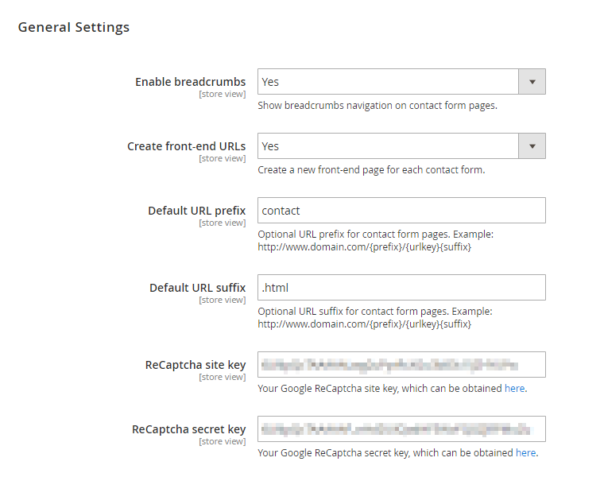
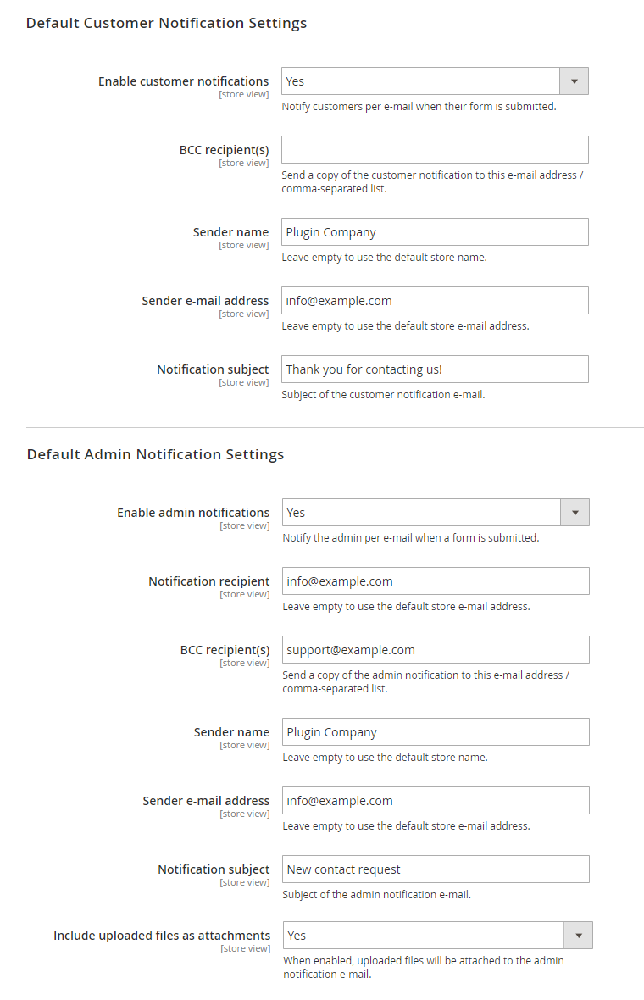

# Configuring Custom Contact Forms

To configure the extension, navigate to **Content > Contact Forms > Configuration** in the left Admin Panel menu, or go to **Stores > Configuration** and select **Plugin Company > Contact Forms** from the left side menu.

Using the extension's config page you can modify the Custom Contact Forms general and default notification settings as further explained below.

It’s possible to configure the extension per store view using the dropdown menu at the top left corner of the page.

To save any changes made in the Custom Contact Forms settings, click the ‘Save Config’ button in the top right corner of the configuration page.

## General Settings

In the General Settings section you can:

- Enable breadcrumbs navigation at the top of contact form pages.
- Choose to create a front-end page for new contact forms by default. This can also be defined for each form separately in the [Form Settings](./09-form-settings.md) tab, where you can enter the form's URL key.
- Optionally enter a default URL prefix and suffix for all form pages.
- Enable ReCaptcha, a free Google spam protection service, by entering your personal API keys. These can be obtained by signing up in [Google reCAPTCHA admin console](https://www.google.com/recaptcha/admin/create).

## Default Notification Settings

In the two bottom sections of the configuration page you can set up the default customer and admin notification settings.

By enabling the e-mail notifications, the customer and/or admin will be notified by e-mail when a contact form has been submitted.

You can enter the default notification recipient(s), the sender name and e-mail address, and the notification subject.

All of these settings can also be configured for each form separately in the [Customer Notification](./12-customer-notification.md) and [Admin Notification](./13-admin-notification.md) tabs.

In the Default Admin Notifications Settings, you can also choose to attach uploaded files to the admin notification e-mail of forms that include the file upload component. Alternatively, you can display all uploaded files as links by adding the variable `{{var uploaded_file_links}}` in the [Admin Notification](./13-admin-notification.md) content.

---

[Documentation index](./README.md) · [README](../README.md) · [Online version](https://plugin.company/knowledge-base/docs/magento2-custom-contact-forms/user-manual/configuring-custom-contact-forms/)
