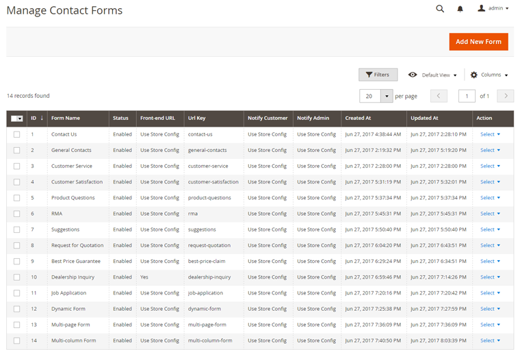

# Creating a Custom Contact Form

Navigate to **Content > Contact Forms > Manage Forms** in the left Admin Panel menu to create and manage your custom contact forms.

Create a new form by clicking the 'Add New Form' button in the top right corner of the page.

Use the following tabs of the form view to create and configure your contact form:

- [Form Builder](./07-form-builder.md)
- [Conditional Form Fields](./08-conditional-form-fields.md)
- [Form Settings](./09-form-settings.md)
- [Front-end Style](./10-front-end-style.md)
- [Custom Javascript](./11-custom-javascript.md)
- [Customer Notification](./12-customer-notification.md)
- [Admin Notification](./13-admin-notification.md)
- [General Translations](./14-translations.md)
- [Form Field Translations](./14-translations.md)
- [Form Submissions](./15-form-submissions.md)
- Store Views (for multi-store setup)

---

[Documentation index](./README.md) · [README](../README.md) · [Online version](https://plugin.company/knowledge-base/docs/magento2-custom-contact-forms/user-manual/creating-a-custom-contact-form/)
