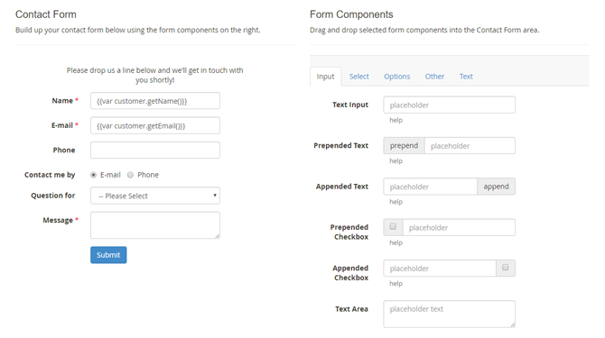
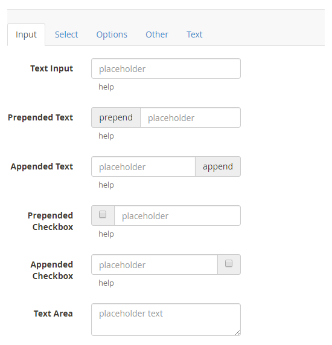
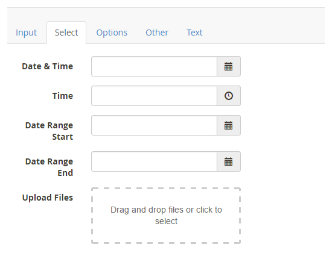
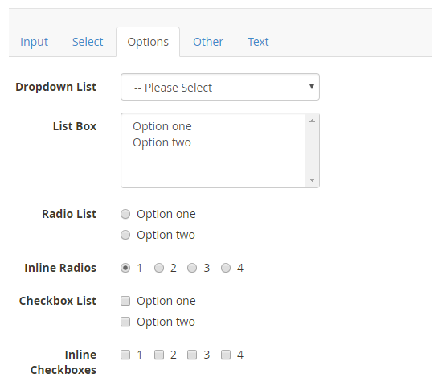
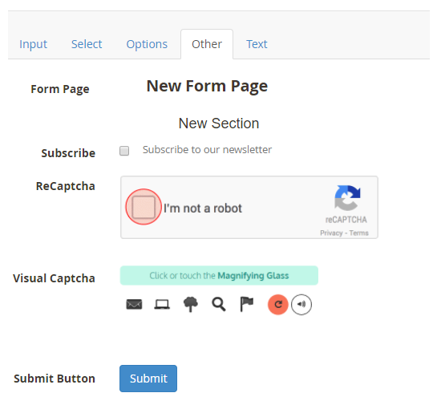
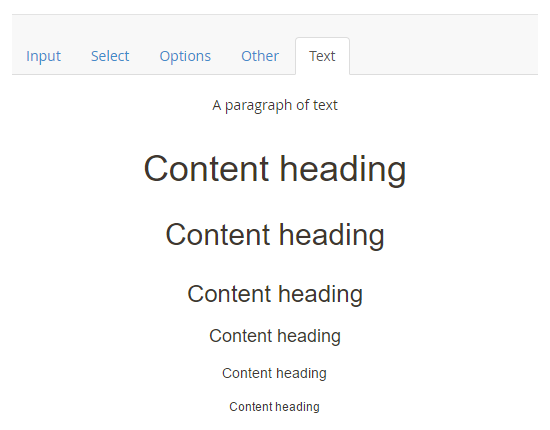
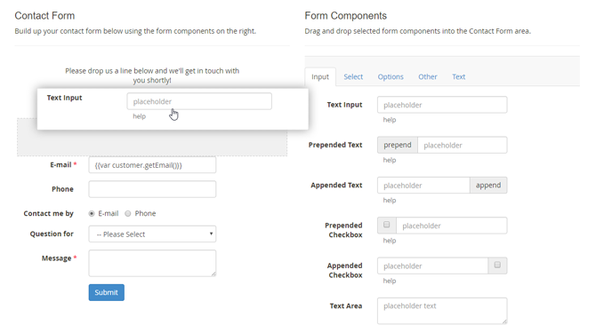
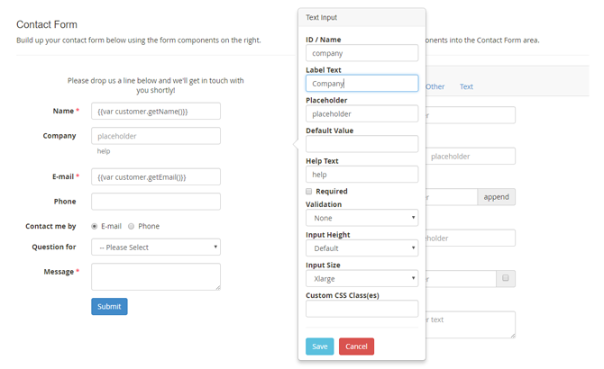
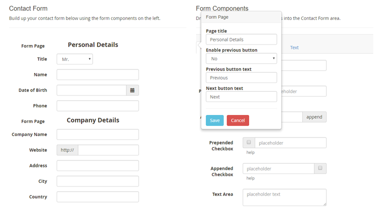
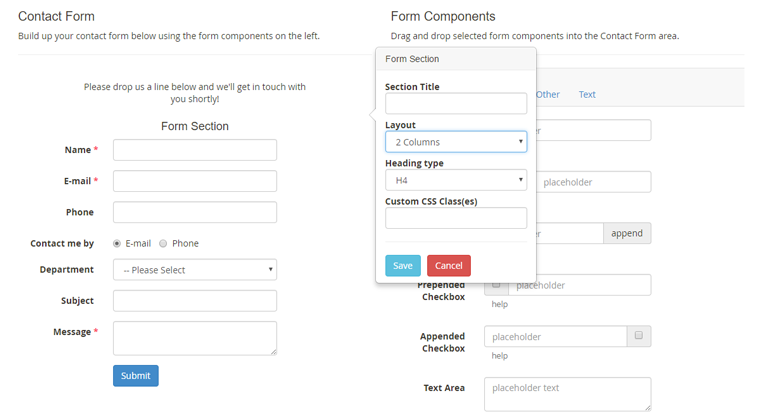

# Form Builder

In the Form Builder interface you can build up your contact form by selecting form components on the right side of the page and dragging and dropping them in the Contact Form area on the left.

When creating a new form, a default contact form will be shown in the Contact Form area which can be used as a starting point. If you prefer to start from scratch, you can remove individual components by dragging them out of the Contact Form area.

You can duplicate an existing form using the 'Copy Form' button at the top of the form view.

## Form Components

The form components are categorized in the five tabs on the right side of the Form Builder.

The **Input** tab contains various text input fields, including fields with a prepended / appended text or checkbox.

The **Select** tab includes fields for selecting dates, date ranges, time and files. With the upload component, files can be selected or dragged and dropped into the upload field.

The **Options** tab provides various fields for selecting one or multiple options. The dropdown menu and radio buttons can be used if only one out of several options should be chosen, while the list box and the checkboxes allow multiple selections.

The **Other** tab contains a [Form Page](#form-page) and [Form Section](#form-section) component, a newsletter subscription checkbox, a submit button and two different Captcha functionalities: Google ReCaptcha and Visual Captcha. Please note that ReCaptcha will only work if it's enabled in the extension's [General Settings](./05-configuring-custom-contact-forms.md#general-settings).

The **Text** tab components can be used to add paragraphs and content headings to the contact form.

### Adding and Moving Form Components

Selected form components can be added to the form and rearranged by dragging and dropping them in the Contact Form area. A grey block will appear when the component is hovering above a suitable space to be dropped.

### Configuring Form Components

Once a form field is added to the contact form, you can configure its settings by selecting it. A pop-over will appear on the right showing the configuration options, which vary per component. You can find a short description of the most important form field settings below.

- The form field **ID / Name** serves as an identifier for admin reference and can also be used as a custom variable in the form's [customer notifications](./12-customer-notification.md) and [admin notifications](./13-admin-notification.md). To make sure all form data is submitted correctly, it's important to assign a unique ID to each form component, without using any spaces. Best practice is to use short IDs that describe the content of the form component, such as *name, email, department, contact-method,* etc.
- The **Label Text** is displayed on the left side of each form component, a **Placeholder** can be shown inside input fields and a **Help Text** can be added below input and selection fields.
- You can optionally enter a **Default Value** for input fields, which also support automatically prefilled variables such as customer name, contact details and product attributes. In the default form, the 'Name' and 'E-mail' fields are automatically filled in for logged in customers using the variables `{{var customer.getName()}}` and `{{var customer.getEmail()}}`. If the specified variables are not found, the input fields remain empty. You can read all about configuring automatically prefilled form variables in [Prefilling Forms Using Variables](./22-prefilling-forms-using-variables.md).
- Most form components can be made **Required**, ensuring that a form cannot be submitted without providing the required data.
- The input fields include an optional **Validation** function which verifies if the input is entered using the correct format (e.g. a number, e-mail address, URL, date, etc).
- The option fields can be configured by entering a list of **Options**, **Radios** or **Checkboxes**, which can include a default/preselected value by adding a \* in front of a specific option, for example *\*Option One*.
- The input and selection components have an adjustable **Input Size** and **Height**.
- All form components can be further customized using the Custom CSS field in the [Front-end Style](./10-front-end-style.md) tab by entering the **Custom CSS Class(es)** per form field.

## Creating Form Pages

The **Form Page** component in the Other tab can be used for dividing your form into multiple pages or tabs, which can be browsed through using the buttons at the bottom of each form page (see [multi-page contact form example](./18-custom-contact-form-front-end-examples.md#multipage)).

Once added to the contact form, each form page can be given a custom title which is shown in a navigation bar at the top of the contact form.

Please note that in order to modify the first form page title, you need to insert a form page component at the top of your contact form as exemplified below.

## Creating Form Sections and Columns

A form can also be divided into multiple sections or columns using the **Form Section** component from the Other tab (see [multi-column contact form example](./18-custom-contact-form-front-end-examples.md#multicolumn)).

Once added to the contact form, you can select the Form Section component to configure its title, layout and heading type in a pop-over.

Using the 'Layout' dropdown menu, you can choose to add a Full Width, 1 Column or 2 Columns section to the contact form. The 2 Columns layout will evenly divide the fields within a section into two columns.

---

[Documentation index](./README.md) · [README](../README.md) · [Online version](https://plugin.company/knowledge-base/docs/magento2-custom-contact-forms/user-manual/form-builder/)
