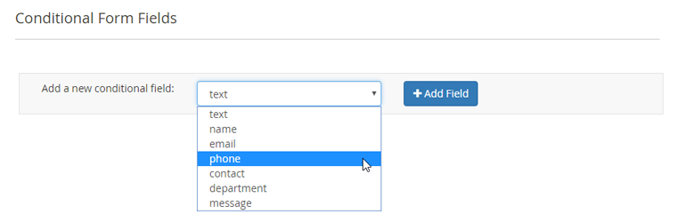
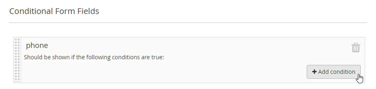
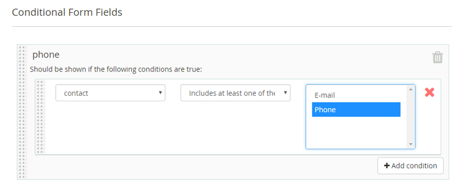

# Conditional Form Fields

In the Conditional Form Fields tab you can make any of the form components that have been added to the contact form conditional, meaning that the form component only appears on the front-end under specified conditions.

Select the form component that should be made conditional from the dropdown menu and click the 'Add Field' button. The form components are listed in the dropdown menu by their IDs which can be edited in the [Form Builder](./07-form-builder.md#configuring-components) tab.

Click the 'Add condition' button to specify under which condition form field A should be shown, choosing the value(s) that should / should not be selected or entered in form field B.

To configure the condition you can choose whether form field B should:

- equal the specified value(s);
- not equal the specified value(s);
- include all of the specified value(s);
- include at least one of the specified value(s);
- match the specified regular expression.

In the example below, the input field 'phone' (A) should be shown under the condition that at least the value 'Phone' is selected from the 'contact-method' dropdown menu (B).

You can add more conditions per form field by clicking the 'Add condition' button, or delete a condition by clicking the red cross icon.

Click the recycle bin icon to delete a conditional form field.

---

[Documentation index](./README.md) · [README](../README.md) · [Online version](https://plugin.company/knowledge-base/docs/magento2-custom-contact-forms/user-manual/conditional-form-fields/)
