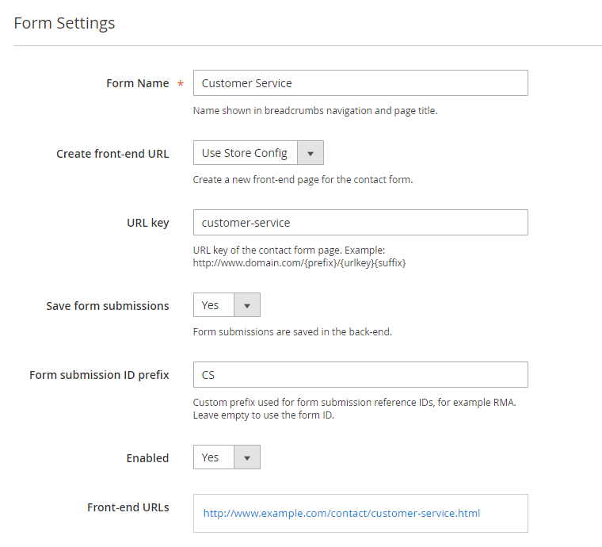

# Form Settings

In the Form Settings tab you can:

- Enter a form name for admin reference, which will be also shown in the breadcrumbs navigation and contact form page title (if applicable).
- Choose to create a new front-end page for the contact form. If you want to add the form to a CMS page, block or layout update instead, you can do this by [creating a custom contact form widget](./16-creating-custom-contact-form-widgets.md).
- Enter a custom URL key for the form page (if applicable). The optional URL prefix and suffix can be modified in the extension's [General Settings](./05-configuring-custom-contact-forms.md#general-settings).
- Choose to save form submissions in the back-end. By enabling this option, submitted form data can be managed in the [Form Submissions](./15-form-submissions.md) tab.
- Enter a custom form submission ID prefix, which can be used as a reference for form submissions that are saved in the back-end. By default the form ID is used as form submission prefix.
- Enable the form to activate it in the front-end store.
- If you chose to create a new page for the contact form, the front-end URL(s) will be displayed at the bottom of the Form Settings tab after the form has been saved.

---

[Documentation index](./README.md) · [README](../README.md) · [Online version](https://plugin.company/knowledge-base/docs/magento2-custom-contact-forms/user-manual/form-settings/)
