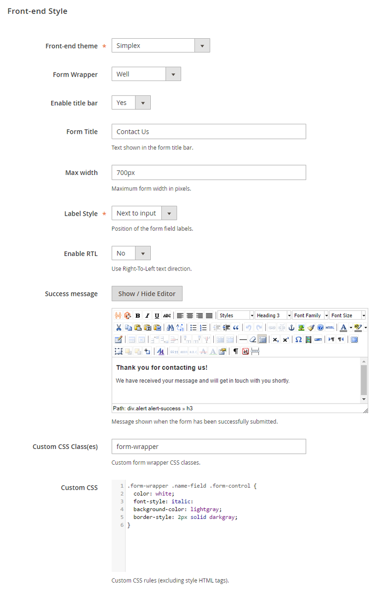

# Front-end Style

In the Front-end Style tab you can:

- Change the appearance of the contact form by choosing one of the 18 integrated Bootstrap themes, or use your custom Bootstrap based store theme.
- Select one of the six form wrapper styles or no wrapper.
- Optionally enable the form title bar and enter a custom form title.
- Set the maximum form width in pixels.
- Choose to show the form field labels next to or above the input fields, or to hide the labels.
- Enable RTL (Right-to-Left) text direction.
- Modify the 'success message' which is displayed on the front-end when a contact form has been successfully submitted.
- Enter custom form wrapper CSS classes and add CSS rules to customize the form's front-end style. To customize specific form components, you can enter CSS classes per form field using the [Form Builder](./07-form-builder.md) interface.

---

[Documentation index](./README.md) · [README](../README.md) · [Online version](https://plugin.company/knowledge-base/docs/magento2-custom-contact-forms/user-manual/front-end-style/)
