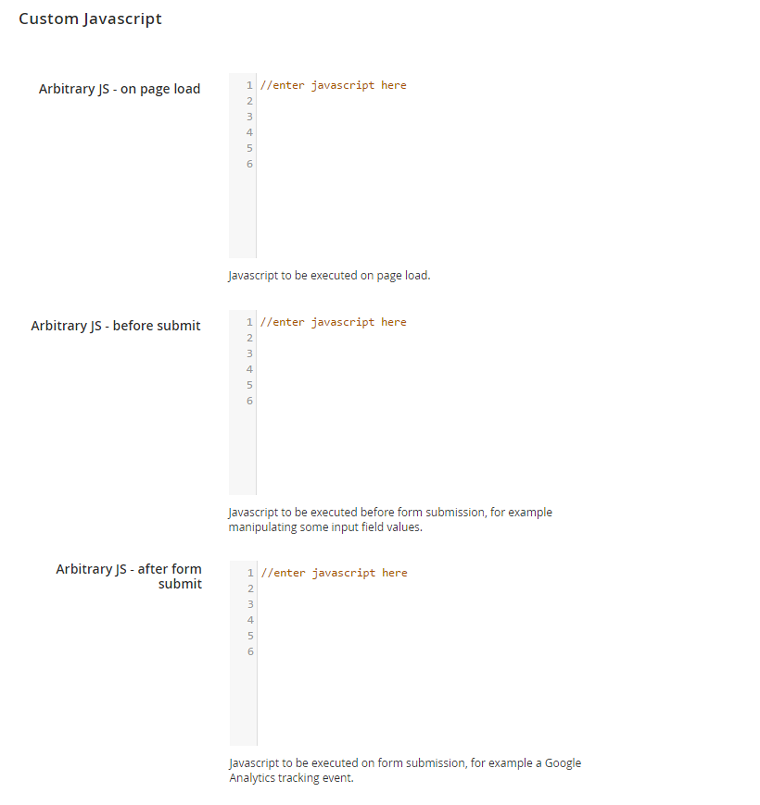

# Custom Javascript

Using the Custom Javascript tab you can add arbitrary Javascript to be executed on page load, before or after form submission.

---

[Documentation index](./README.md) · [README](../README.md) · [Online version](https://plugin.company/knowledge-base/docs/magento2-custom-contact-forms/user-manual/custom-javascript/)
