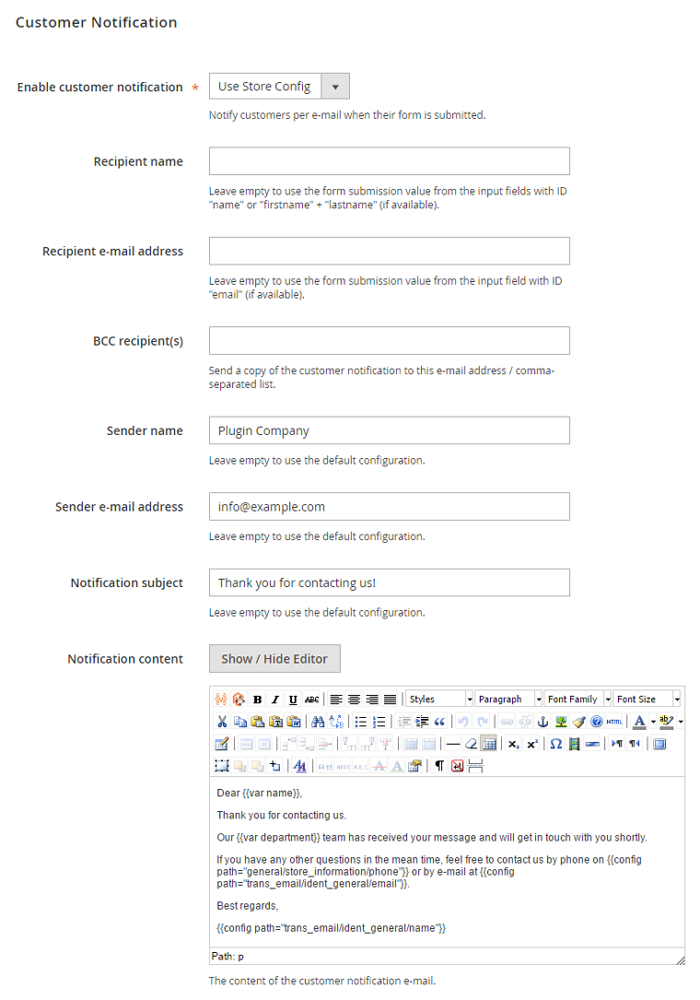

# Customer Notification

In the Customer Notification tab you can configure the e-mails that are sent to the customer and optional BCC recipients when a contact form has been submitted (if enabled).

You can also choose to use the [default customer notifications settings](./05-configuring-custom-contact-forms.md#default-notifications).

By default, the recipient name and e-mail address will be fetched from the form input fields with ID 'name' (or 'firstname' + 'lastname') and 'email'. If these form field IDs are modified in the [Form Builder](./07-form-builder.md#configuring-components) tab they need to be updated accordingly in the customer notification settings, by entering the ID preceded by 'var' and wrapped in double brackets, for example `{{var customer_name}}`.

The notification content supports the use of Magento's default store variables as well as custom contact form variables, which can be used to automatically include submitted form data in your e-mail notifications.

Custom contact form variables can be added to the e-mail by wrapping the corresponding form field ID preceded by 'var' in double brackets, for example `{{var department}}` or `{{var contact-method}}`. The form field IDs can be configured in the [Form Builder](./07-form-builder.md#configuring-components) tab.

---

[Documentation index](./README.md) · [README](../README.md) · [Online version](https://plugin.company/knowledge-base/docs/magento2-custom-contact-forms/user-manual/customer-notification/)
