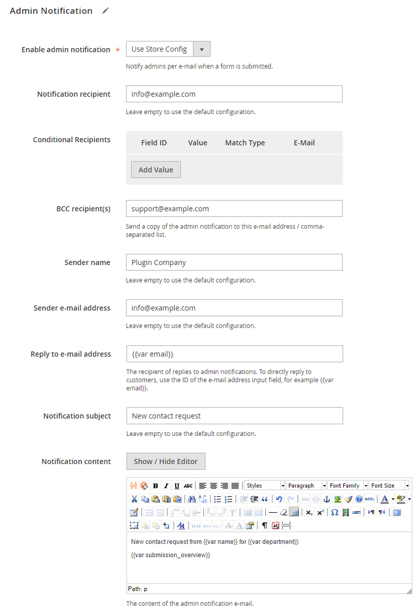
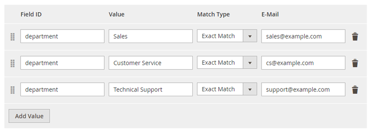
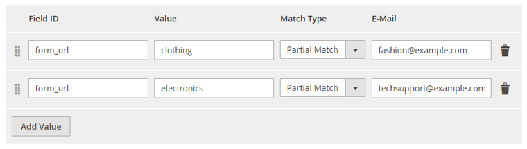

# Admin Notification

In the Admin Notification tab you can configure the e-mails that are sent to the admin and optional BCC recipients when a contact form has been submitted (if enabled).

You can also choose to use the [Default Admin Notifications Settings](./05-configuring-custom-contact-forms.md#default-notifications).

The 'Conditional recipient(s)' option can be used to send a copy of the admin notification to e-mail addresses on condition that a specific form field value is submitted.

The conditional notification recipient can be configured by entering the form field ID and its conditional value, followed by the recipient's e-mail address.

Using the 'Match Type' dropdown menu you can choose whether the form field submission should exactly or partially match the conditional value.

By entering the variable 'form_url' in the Field ID input field, you can set up conditional admin recipients based on the front-end URL on which the contact form has been submitted. This can be useful when the contact form is used on multiple store pages, such as a product questions form.

The 'Reply to e-mail address' is the recipient of replies to admin notifications, which by default is set to the notification sender e-mail address. By using the variable `{{var email}}`, the submitted e-mail address from the form field with ID 'email' will be used as the reply recipient, making it possible to directly reply to the customer.

The notification content supports the use of Magento's default store variables as well as custom contact form variables, which can be used to automatically include submitted form data in your e-mail notifications.

Custom contact form variables can be added to the e-mail by wrapping the corresponding form field ID preceded by 'var' in double brackets, for example `{{var department}}`. The form field ID's can be configured in the [Form Builder](./07-form-builder.md#configuring-components) tab.

The variable `{{var submission_overview}}` will include all submitted form data in the admin notification, plus the front-end URL on which the form was submitted and the visitor's IP address. These two values can also be added to admin notifications individually using the variables `{{var form_url}}` and `{{var visitor_ip}}`.

Using the variable `{{var uploaded_file_links}}` you can display all uploaded files as links in the admin notification e-mail. Alternatively, you can choose to attach uploaded files to the e-mail by enabling the 'Include uploaded files as attachments' option in the [Default Admin Notifications Settings](./05-configuring-custom-contact-forms.md#default-notifications).

---

[Documentation index](./README.md) · [README](../README.md) · [Online version](https://plugin.company/knowledge-base/docs/magento2-custom-contact-forms/user-manual/admin-notification/)
