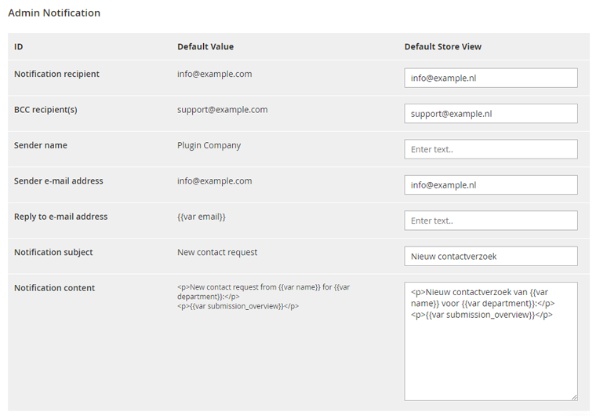
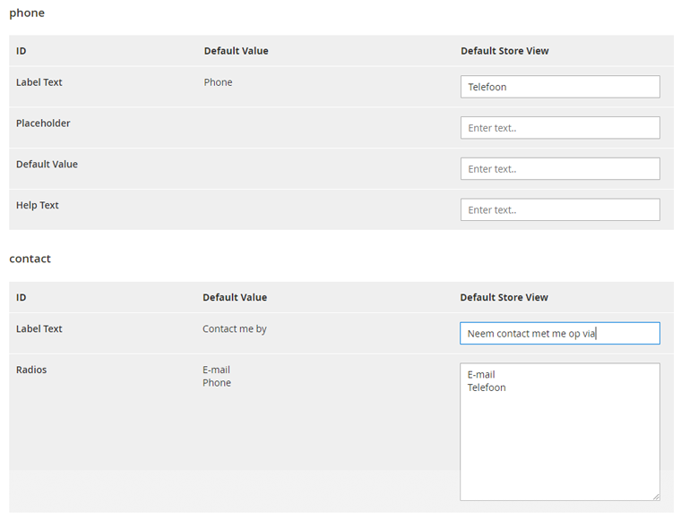

# Translations

As of Custom Contact Forms v100.5.0, it's possible to translate all form fields and notification e-mails for each store view in the General Translations and Form Field Translations tab of the form view.

## General Translations

The General Translation tab can be used to translate the front-end form title and success message and all input values related to customer and admin e-mail notifications.

In this way you can specify the sender and recipient names, e-mail addresses, subjects and notification content for each store view / language.

When a translation field is left empty, the default value will be used.

## Form Field Translations

Using the Form Field Translations tab you can translate all front-end form fields and values including the label text, options, placeholder text and default values for each store view.

When a translation field is left empty, the default value will be used.

---

[Documentation index](./README.md) · [README](../README.md) · [Online version](https://plugin.company/knowledge-base/docs/magento2-custom-contact-forms/user-manual/translations/)
