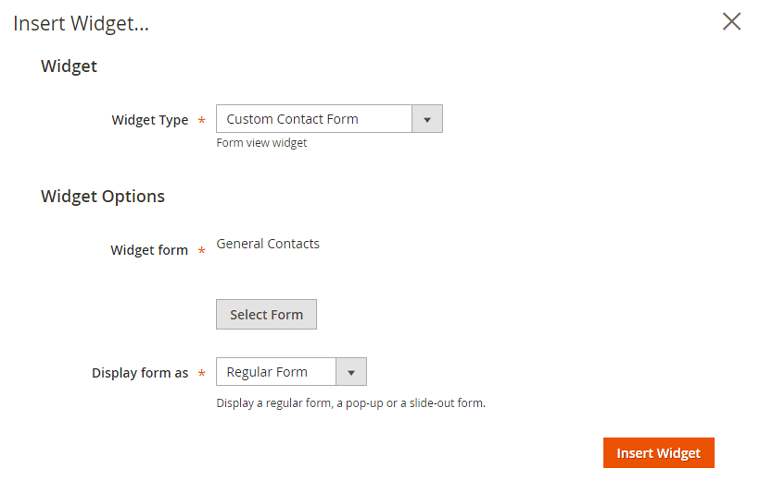
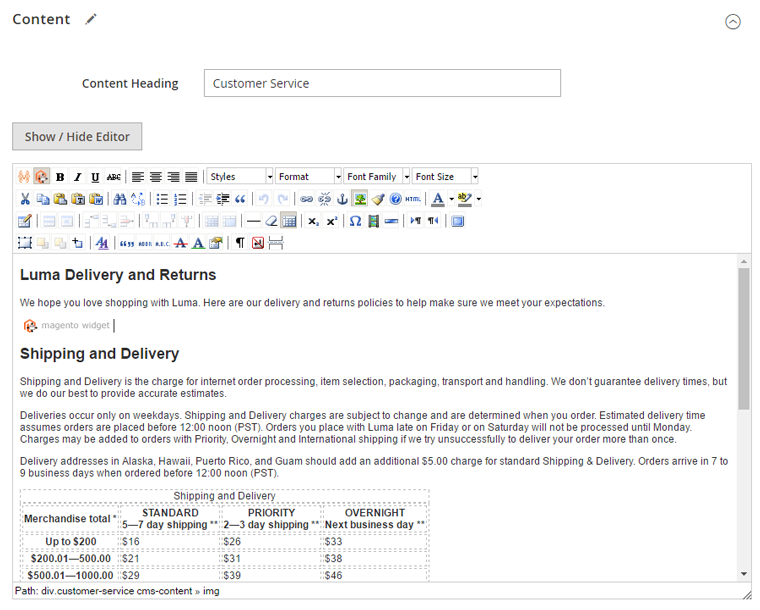
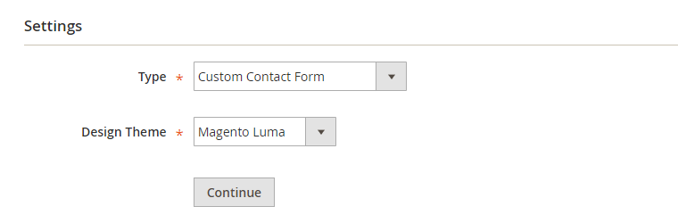
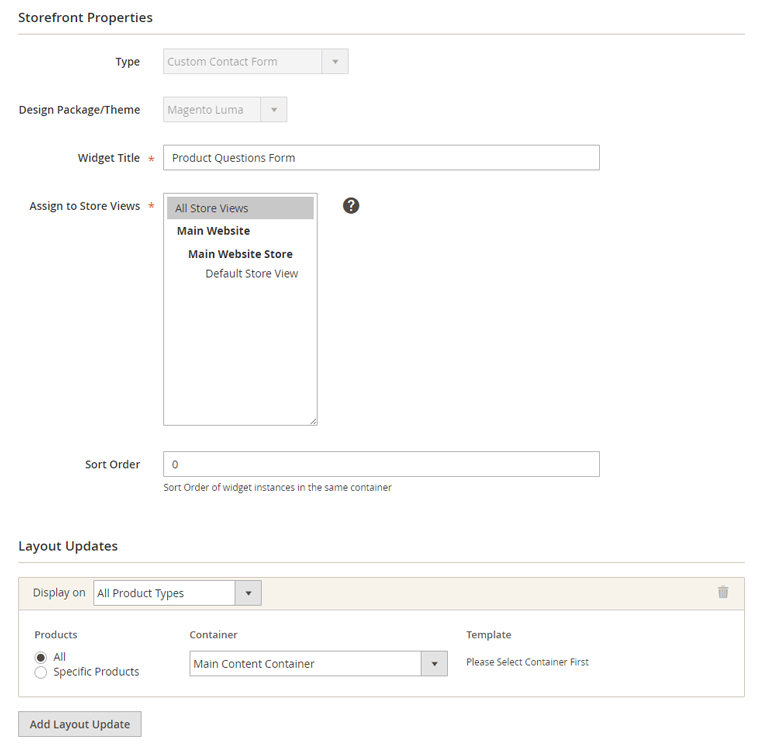
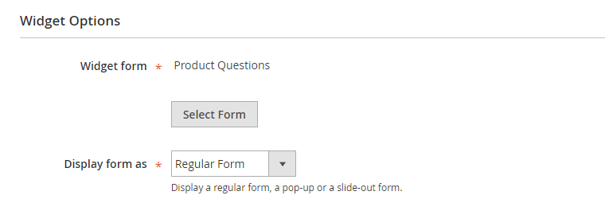

# Creating Custom Contact Form Widgets

Contact forms can be inserted anywhere in your Magento store by creating a custom contact form widget.

The contact form widget can be easily inserted in pages or blocks or displayed in specific layout updates as further explained below.

The widget can be also used to create [pop-up forms](./17-widget-options.md#pop-up-widget) or [slide-out forms](./17-widget-options.md#slide-out-widget).

## <a id="embedded-widget"></a>Adding Contact Forms to Pages and Blocks

If you want to add one or multiple contact forms to a page or block, you can insert the form using a widget by clicking the 'Insert Widget' button / icon above the content editor.

Please note that when using Page Builder (Magento Commerce 2.3.1+, Magento Open Source 2.4.3+), you'll have to add a 'Text' element first in which you can add the widget using the 'Insert Widget' button.

Select the widget type 'Custom Contact Form' and click 'Select Form' to choose a contact form.

You can choose to insert a regular form, a pop-up or a slide-out form widget. Depending on the selected display type you can configure additional pop-up or slide-out display options in the [Widget Options](./17-widget-options.md) section.

Click the 'Insert Widget' button to [embed the form in a page or block](./18-custom-contact-form-front-end-examples.md#embedded-form).



This will add a widget code snippet / icon to the content editor, which can be moved to any desired place in the page or block content to move the contact form.



## <a id="widget-code"></a>Adding Contact Forms to Pages and Blocks using Widget Code

As an alternative to the method mentioned above, you can also add Custom Contact Form widgets directly in CMS Pages and Blocks using the widget shortcode.

Regular Contact Form shortcode example:

```text
{{widget type="PluginCompany\ContactForms\Block\Form\Widget\View" form_id="1" show_form_as="form" type_name="Custom Contact Form"}}
```

Pop-up Contact form shortcode example:

```text
{{widget type="PluginCompany\ContactForms\Block\Form\Widget\View" form_id="1" show_form_as="popup" popup_max_width="600px" display_as_button="1" link_title="Contact us" wrap_in_block="0" auto_hide_popup="0" type_name="Custom Contact Form"}}
```

Slide-out Contact form shortcode example:

```text
{{widget type="PluginCompany\ContactForms\Block\Form\Widget\View" form_id="1" show_form_as="slideout" auto_hide="0" slideout_position="left" title="Contact us" title_color="#FFFFFF" button_color="#EE6E73" type_name="Custom Contact Form"}}
```

## <a id="layout-widget"></a>Adding Contact Forms to Layout Updates

If you want to add a contact form to a specific section of a page layout, such as a sidebar, footer or [product page block](./18-custom-contact-form-front-end-examples.md#layout-form), you can create a widget using the **Content > Widgets** interface by clicking the 'Add Widget' button in the top right corner of the page.

Select the widget type 'Custom Contact Form' and your store's design theme and click 'Continue'.



In the Storefront Properties tab, enter a widget title for admin reference and select the applicable store views.

Specify where you'd like to display the form in the Layout Updates section at the bottom of the Storefront Properties tab.



Select a contact form in the [Widget Options](./17-widget-options.md) tab, where you can configure additional pop-up and slide-out settings depending on the selected display type.



Save the widget and **refresh the cache** to add the contact form to the specified layout in your front-end store.

---

[Documentation index](./README.md) · [README](../README.md) · [Online version](https://plugin.company/knowledge-base/docs/magento2-custom-contact-forms/user-manual/creating-custom-contact-form-widgets/)
