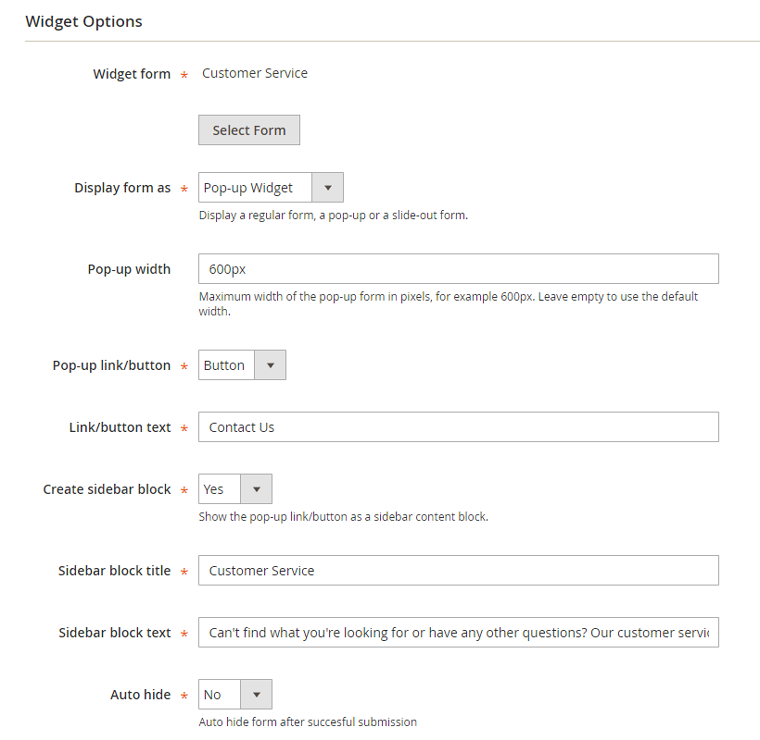
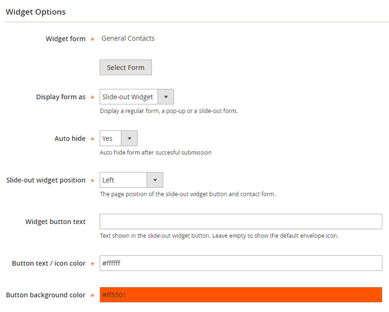

# Widget Options

When creating a contact form widget you can configure the front-end display options in the Widget Options section / tab as further explained below.

## Creating a Pop-up Contact Form

To create a [pop-up form](./18-custom-contact-form-front-end-examples.md#pop-up-form), follow the instructions for [creating a custom contact form widget](./16-creating-custom-contact-form-widgets.md) and choose the display type 'Pop-up Widget' in the Widget Options section or tab.

In the Widget Options you can select a contact form, configure the maximum pop-up width, choose to display a pop-up link or button and enter the link / button text.

If you'd like to display the pop-up link or button in a sidebar, you can optionally create a [sidebar block](./18-custom-contact-form-front-end-examples.md#sidebar-widget) and customize its title and content.

Alternatively you can add the pop-up link / button to [pages or blocks](./16-creating-custom-contact-form-widgets.md#embedded-widget) or specific [layout updates](./16-creating-custom-contact-form-widgets.md#layout-widget).

## Creating a Slide-out Contact Form

The Custom Contact Forms extension also includes a slide-out form widget, adding a button to the side of the front-end store from where the contact form appears when clicked on.

To create a [slide-out contact form](./18-custom-contact-form-front-end-examples.md#slide-out-form), follow the follow the instructions for [creating a custom contact form widget](./16-creating-custom-contact-form-widgets.md) and choose the display type 'Slide-out Widget' in the Widget Options section or tab.

In the Widget Options you can select a contact form and configure the position of the slide-out form widget.

Besides that you can customize the slide-out button text and colors.

---

[Documentation index](./README.md) · [README](../README.md) · [Online version](https://plugin.company/knowledge-base/docs/magento2-custom-contact-forms/user-manual/widget-options/)
