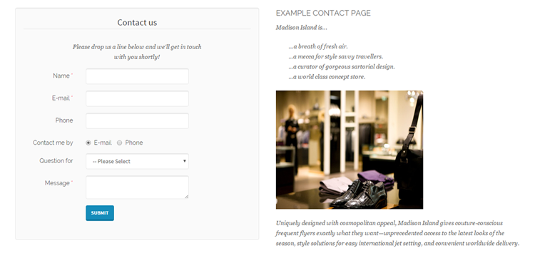

# Adding Forms to CMS Pages and Blocks

You can easily insert one or multiple forms into Magento CMS pages and blocks using the Custom Contact Forms widget.

To add the widget to a CMS page or block, click the ‘Insert Widget’ button above the CMS content editor.

Select the widget type ‘Custom Contact Form’ and click the 'Select Form' button to choose a form from the Custom Contact Forms grid.

If you'd like to add a pop-up form to the page or block, you can configure its settings in the Widget Options section after enabling the 'Display as pop-up' option.

Click the ‘Insert Widget’ button at the top right to embed the selected form in a CMS page or block.

This will add a widget code snippet to the content editor, which can be moved to any desired place in the page or block content to move the contact form.

Example of a custom contact form embedded in a CMS page:

---

[Documentation index](./README.md) · [README](../README.md) · [Online version](https://plugin.company/knowledge-base/docs/magento2-custom-contact-forms/tutorials/adding-forms-to-cms-pages-and-blocks/)
