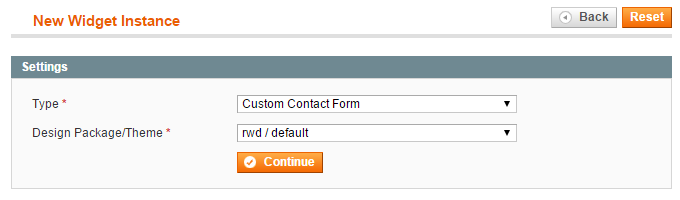
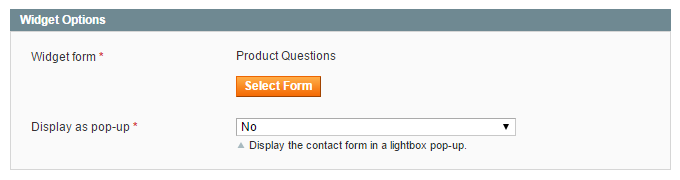
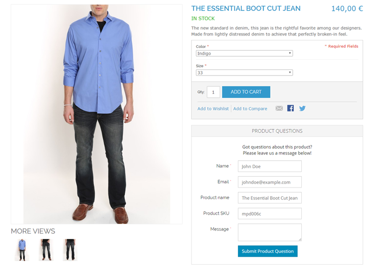

# Adding Forms to Layout Updates

Besides [adding forms to CMS pages and blocks](https://plugin.company/knowledge-base/docs/magento-custom-contact-forms/tutorials/adding-forms-to-cms-pages-and-blocks/), you can also use the Custom Contact Forms widget to insert forms in a specific section of a page layout, such as a sidebar, footer or product page block.

To add a contact form to a layout update you'll need to create a widget using the **CMS > Widgets** interface by clicking the 'Add New Widget Instance' button in the top right corner of the page.

Select the widget type ‘Custom Contact Form’ and your store's Design Package / Theme and click 'Continue'.

In the Frontend Properties tab, enter a 'Widget Instance Title' for admin reference and select the applicable store views.

Specify where you'd like to display your contact form in the Layout Updates section at the bottom of the Frontend Properties tab.

You can select the contact form you'd like to insert in the Widget Options tab and optionally configure the pop-up display settings by enabling the 'Display as pop-up' option.

After saving the widget and **refreshing the cache**, the contact form should have been added to the specified layout update in your front-end store as in the product page example below.

---

[Documentation index](./README.md) · [README](../README.md) · [Online version](https://plugin.company/knowledge-base/docs/magento2-custom-contact-forms/tutorials/adding-forms-to-layout-updates/)
