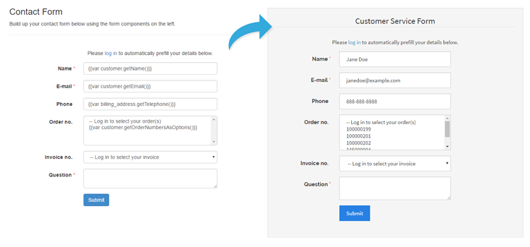

# Prefilling Forms Using Variables



The **Default Value** option for input field allows you to prefill forms with any desired information, including variables that can be used to auto-complete forms with any attribute related to the following objects:

- `product`
- `category`
- `customer`
- `shipping_address`
- `billing_address`

The variables are always composed of one of the **objects** listed above and an **attribute code** starting with a capital (for example *Name, Email, Sku, Street1):*

`{{var object.getAttribute()}}`

When creating a new form in the form builder, you'll notice that the default Name and E-mail input fields contain the variables `{{var customer.getName()}}` and `{{var customer.getEmail()}}`. These variables can be used to automatically prefill your forms for logged in customers with their name and e-mail address. If these variables cannot be found (i.e. the customer is not logged in to his account while submitting the form), the input fields will remain empty on the front-end.

In the same way you could automatically prefill the customer's address using the variable `{{var billing_address.getStreet1()}}`, in which 'Street1' refers to the first line of the billing address street. Or auto-complete product question forms with any desired attribute such as the product name or SKU using the variables `{{var product.getName()}}` and `{{var product.getSku()}}`, which will be auto-completed if the form is embedded on a product page with the custom contact form widget as exemplified below.

You can find all product attribute codes in the Admin Panel by navigating to **Catalog > Attributes > Manage Attributes.** The most common variables related to customer, shipping / billing address, category and store attributes are listed below.

You can also include `{{config path="..."}}` code for store configuration values like store name, phone, address etc.

## Customer variables

```text
{{var customer.getName()}}
{{var customer.getFirstname()}}
{{var customer.getLastname()}}
{{var customer.getEmail()}}
{{var customer.getEntityId()}}
{{var customer.getGroupId()}}
{{var customer.getStoreId()}}
{{var customer.getCreatedAt()}}
{{var customer.getUpdatedAt()}}
{{var customer.getIsActive()}}
```

## Shipping / billing address variables

```text
{{var billing_address.getFirstname()}}
{{var billing_address.getMiddlename()}}
{{var billing_address.getLastname()}}
{{var billing_address.getCompany()}}
{{var billing_address.getStreet()}}
{{var billing_address.getStreet1()}}
{{var billing_address.getStreet2()}}
{{var billing_address.getStreet3()}}
{{var billing_address.getStreetFull()}}
{{var billing_address.getCity()}}
{{var billing_address.getCountryId()}}
{{var billing_address.getCountry()}}
{{var billing_address.getRegion()}}
{{var billing_address.getRegionId()}}
{{var billing_address.getRegionCode()}}
{{var billing_address.getPostcode()}}
{{var billing_address.getTelephone()}}
{{var billing_address.getFax()}}
{{var billing_address.getCustomerId()}}
```

## Category variables

```text
{{var category.getName()}}
{{var category.getDescription()}}
{{var category.getUrlKey()}}
{{var category.getUrlPath()}}
{{var category.getEntityId()}}
{{var category.getEntityTypeId()}}
{{var category.getAttributeSetId()}}
{{var category.getParentId()}}
{{var category.getMetaTitle()}}
{{var category.getCreatedAt()}}
{{var category.getPath()}}
{{var category.getPosition()}}
{{var category.getLevel()}}
{{var category.getIsActive()}}
{{var category.getIncludeInMenu()}}
```

## Product variables

```text
{{var product.getName()}}
{{var product.getSku()}}
{{var product.getPrice()}}
{{var product.getFinalPrice()}}
{{var product.getFormattedPrice()}}
{{var product.getFormattedPriceWithoutContainer()}}
{{var product.getFormattedPriceNoContainerAndSymbol()}}
```

## Other variables

Base Unsecure URL:

`{{config path="web/unsecure/base_url"}}`

Base Secure URL:

`{{config path="web/secure/base_url"}}`

General Contact Name:

`{{config path="trans_email/ident_general/name"}}`

General Contact Email:

`{{config path="trans_email/ident_general/email"}}`

Sales Representative Contact Name:

`{{config path="trans_email/ident_sales/name"}}`

Sales Representative Contact Email:

`{{config path="trans_email/ident_sales/email"}}`

Custom1 Contact Name:

`{{config path="trans_email/ident_custom1/name"}}`

Custom1 Contact Email:

`{{config path="trans_email/ident_custom1/email"}}`

Custom2 Contact Name:

`{{config path="trans_email/ident_custom2/name"}}`

Custom2 Contact Email:

`{{config path="trans_email/ident_custom2/email"}}`

Store Name:

`{{config path="general/store_information/name"}}`

Store Phone Number:

`{{config path="general/store_information/phone"}}`

Store Hours:

`{{config path="general/store_information/hours"}}`

Country:

`{{config path="general/store_information/country_id"}}`

Region/State:

`{{config path="general/store_information/region_id"}}`

Zip/Postal Code:

`{{config path="general/store_information/postcode"}}`

City:

`{{config path="general/store_information/city"}}`

Street Address 1:

`{{config path="general/store_information/street_line1"}}`

Street Address 2:

`{{config path="general/store_information/street_line2"}}`

---

[Documentation index](./README.md) · [README](../README.md) · [Online version](https://plugin.company/knowledge-base/docs/magento2-custom-contact-forms/tutorials/prefilling-forms-using-variables/)
