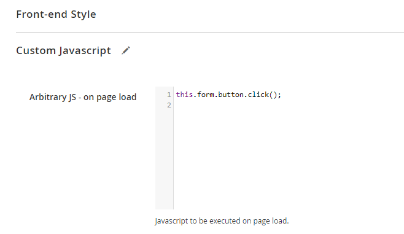

# Open a Pop-up Form on Page Load

In some cases it might be useful to show a pop-up form directly on page load. Below you'll find instructions how to do this.

## Instructions for v100.10.0 and up:

Go to the edit form page in the admin area and add the following code to the `Custom Javascript > Arbitrary JS - on page load` field:

```
this.form.button.click();
```



## Instructions for v100.9.4 and lower:

Go to the edit form page in the admin area and add a custom class name to the form at `Front-end Style > Custom CSS Class(es)`

In this case we'll add the class `auto-open` to the form:


Now add the following code to the `Custom Javascript > Arbitrary JS - on page load` field:

```js
jQuery('.auto-open').parent().parent().find('a').click()
```

---

[Documentation index](./README.md) · [README](../README.md) · [Online version](https://plugin.company/knowledge-base/docs/magento2-custom-contact-forms/tutorials/open-pop-up-form-on-page-load/)
