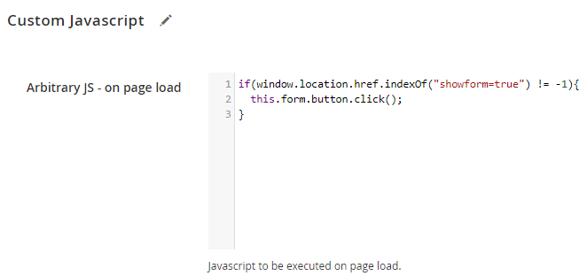
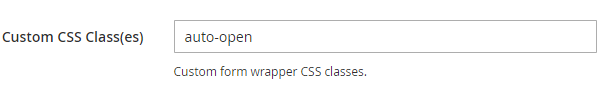
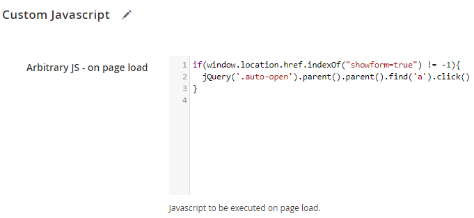

# Open a Pop-up Form Based on a URL Parameter

In some cases it might be useful to show a pop-up form directly on page load when a specific URL parameter is set. Below you'll find instructions how to do this.

In this example we'll assume the query parameter used is `?showform=true`

## Instructions for v100.10.0 and up:

Go to the edit form page in the admin area and add the following code to the `Custom Javascript > Arbitrary JS - on page load` field:

```
if(window.location.href.indexOf("showform=true") != -1){
  this.form.button.click();
}
```



## Instructions for v100.9.4 and lower:

Go to the edit form page in the admin area and add a custom class name to the form at `Front-end Style > Custom CSS Class(es)`

In this case we'll add the class `auto-open` to the form:



Now add the following code to the `Custom Javascript > Arbitrary JS - on page load` field:

```js
if(window.location.href.indexOf("showform=true") != -1){
  jQuery('.auto-open').parent().parent().find('a').click()
}
```



---

[Documentation index](./README.md) · [README](../README.md) · [Online version](https://plugin.company/knowledge-base/docs/magento2-custom-contact-forms/tutorials/automatically-open-pop-up-form-based-on-url-query-parameter/)
